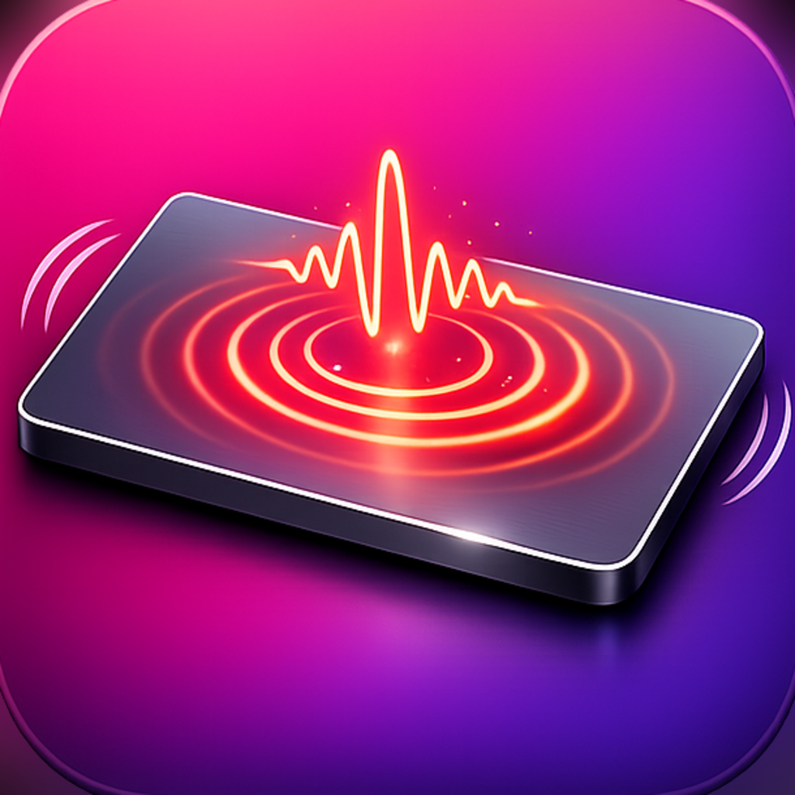
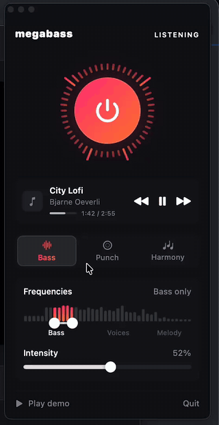
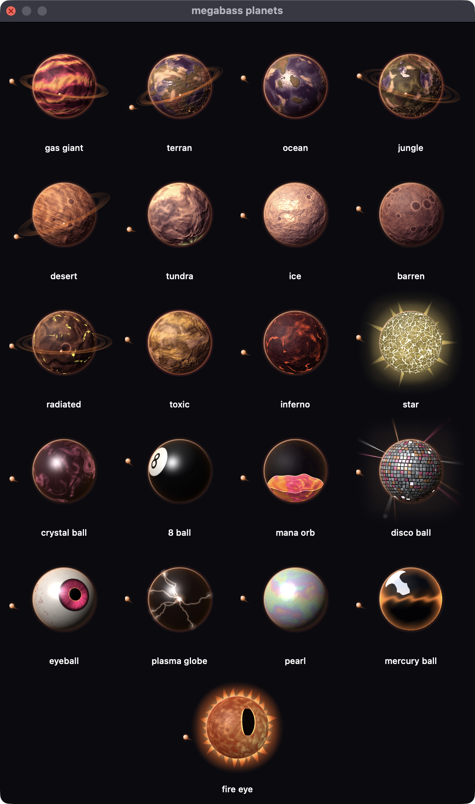

# megabass

<p align="center"></p>

A macOS menu-bar app that plays your music on the trackpad. Spotify, Music, YouTube or
[cliamp](https://github.com/bjarneo/cliamp) keeps playing through your speakers. megabass listens to
the same audio and replays its low end on the Force Touch haptic motor, cycle by cycle and in time
with the speakers. Notes that stand out above the bass (a sung line, a lead) can ride along.

<p align="center"></p>
<p align="center"><a href="docs/demo.mp4">Watch with sound (MP4)</a></p>

## Use it

Click the planet to switch the trackpad on. It pulses with the bass and the trackpad starts to play.

| Control | What it does |
|---------|--------------|
| **Planet** | On and off. Hover it to turn the power icon toward you. |
| **Range** | The live spectrum of what your Mac plays, 20 Hz to 4 kHz. Drag the handles, or draw across the bars, to pick what the trackpad plays: Deep (bass), Voices, Melody. Bass replays the music's own waveform, one motor period per bass period; above 160 Hz, notes that stand out from the mix ride along. |
| **Strength** | How hard the motor works. |
| **Overdrive** | Kicks hit harder, with extra rumble, and the planet headbangs harder. |
| **Now playing** | Spotify, Music or [cliamp](https://github.com/bjarneo/cliamp): track, seek, previous, play/pause, next. The source menu switches players and cliamp stations. |
| **Widget** | The corner icon turns megabass into just the planet, in a small floating window; controls show on hover. |
| **Dice** | A new random planet for the current song. |

## The planet

The power button is a small procedural world, hashed from the station (or the Spotify/Music song):
12 types (gas giant, terran, ocean, jungle, desert, tundra, ice, barren, radiated, toxic, inferno,
star), fractal surfaces with bump and specular lighting, clouds, city lights, rings and moons that
react to the music. It spins faster as the song grows more intense, with a heavy body's inertia,
and headbangs in half time: fully down on beats 1 and 3, at the tempo `TempoTracker` hears.
Prominent voices (a sung or lead note) launch new satellites off its face on tiny rockets (the spent
stage falls back), up to 10, orbiting at a height set by the note, on the same plane as its rings; when their time is up they fall back and
strike the surface in a burst of sparks. A band that shoots up faster than the song's usual blasts
a solar prominence off the limb: a white-hot loop of plasma that cools and lingers a few seconds.
Around it: vizamp's particle ridge bent into a circle, pulses up the stalks, sparks under the
planet's gravity, stalks and ridge glowing like hot metal, and a MilkDrop feedback layer that leans
toward your cursor. Hover the planet for its style code. `--gallery` shows every type.

<p align="center"></p>

Can't see the menu-bar icon? A menu-bar manager such as Bartender, or the notch, may hide it.
Open megabass again from Spotlight, Alfred or Finder and its panel appears as a floating window.

## Build and run

Needs macOS 14.4+ (Core Audio process taps), Apple Silicon, a Force Touch trackpad and the Command
Line Tools.

```sh
./build.sh && open build/megabass.app
```

On first switch-on macOS asks for **System Audio Recording**. Without it the tap hears only
silence from other apps. **Play demo** works without any permission.

The build is ad-hoc signed, so macOS may ask for the permission again after a rebuild.

## How it works

- `SystemTap`: a private Core Audio process tap on all output. You don't need a virtual device or driver.
- `CycleTracker`: band-passes the low band and cuts it into single periods at upward zero
  crossings. It emits each period as it starts, predicted from the previous one, which saves a period of lag.
- `ToneTracker`: every 10 ms, the strongest spectral peak in the upper band. It skips the bass
  overtones and requires 6× prominence plus a 40 ms steady hold.
- `SpectrumAnalyzer`: 40 log bands, 20 Hz to 4 kHz, drawn as the Frequencies track.
- `TempoTracker`: the song's tempo and beat grid for the planet's headbang. An onset envelope at
  200 frames a second, autocorrelated over 8 s (60-160 BPM; faster songs read half time), with
  the phase from a two-beat comb so the nod lands on beats 1 and 3.
- `HapticVoice`: a high-priority thread that schedules actuations for when the speakers play
  that audio (capture time + device output latency).
- `Motor`: the Force Touch actuator through the private MultitouchSupport framework.
- `VoiceSpotter`: a band in 150 Hz-2 kHz that stands out of the spectrum around it, rises above its
  own recent level and holds 100 ms; each one births a satellite.
- `CliampBridge`: cliamp's CLI/IPC (`status --json`, `toggle`, `next`, `load`). It polls only while the panel is open.

## Checks

`swift build -c release --product mbcheck`, then:

| Command | Bar | Last result |
|---------|-----|-------------|
| `mbcheck cycles` | sines within 1 %, bass stem ≥ 85 % on note, no dropouts | 0.01 %, 100 %, 100 % |
| `mbcheck tones` | melody over groove ≥ 80 % on pitch, noise ≤ 5 % | 93 %, 0 % |
| `mbcheck tempo` | demo groove played at 84-140 BPM: tempo ±0.5 BPM, beats within 30 ms, half-time bang on 1 and 3 | ≤0.29 BPM, ≤18 ms, 100 % |
| `mbcheck voices` | a sung line over the groove births satellites, the groove alone doesn't | 80 % of notes, 1 false in 20 s, pitch order 77 % |
| `mbcheck pitch` | bass pitch class ≥ 90 %, kick recall ≥ 90 % within 30 ms | 92.8 %, 100 % at 20 ms |
| `mbcheck e2e 6 bass` | speakers → tap → motor, periods start within ±40 ms of the sound | +13 ms |
| `mbcheck live bass 20` | live log of whatever the Mac plays (the calling app needs the permission) | |

Real music through the app: launch with `--on --diag /path/to/diag.txt` for a once-a-second line of
input level, bass periods/s, tones/s, actuations/s and sync. With cliamp playing lofi: −16 dBFS in,
58-73 periods/s, 62-75 actuations/s, +1 to +21 ms after the speakers.

## Icon

`tools/replicate_icon.py` generates candidates on Replicate (`openai/gpt-image-2.6-sunburst`) from
`tools/icon_prompt.txt`; `tools/pack_icon.sh` packs a 1024 px PNG into `AppIcon.icns`. The art is
full bleed so macOS 26 applies its own mask.

## Credits

The trackpad-as-sound-source technique (MultitouchSupport actuations of sine "Tones") comes from
[nospeaker](https://github.com/os6/nospeaker) by Cody Collier, MIT License. The player integration
drives [cliamp](https://github.com/bjarneo/cliamp) by Bjarne Øverli, MIT License.
